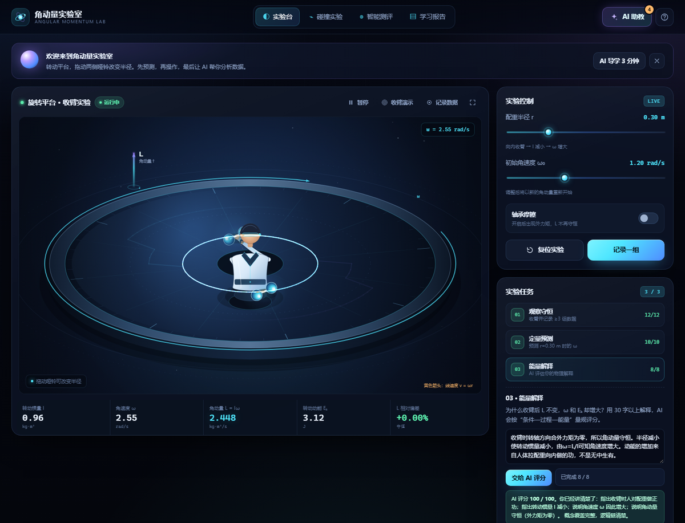
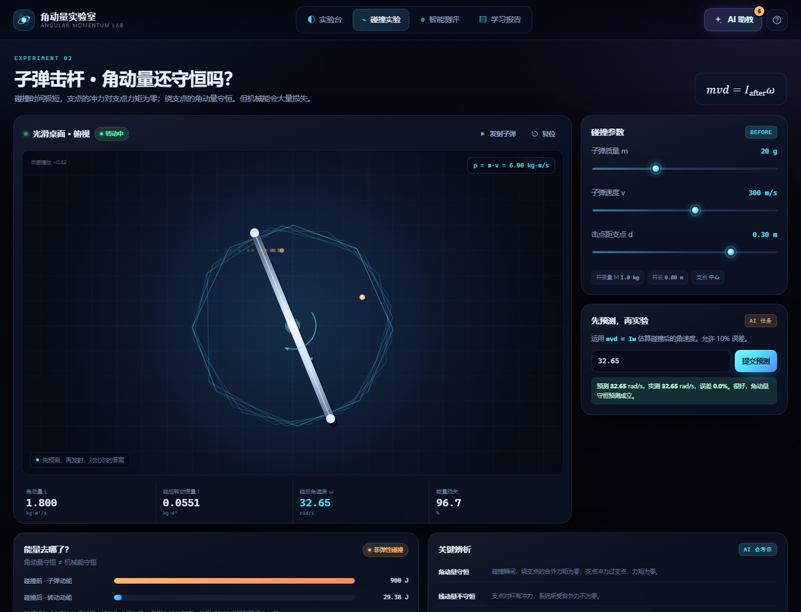
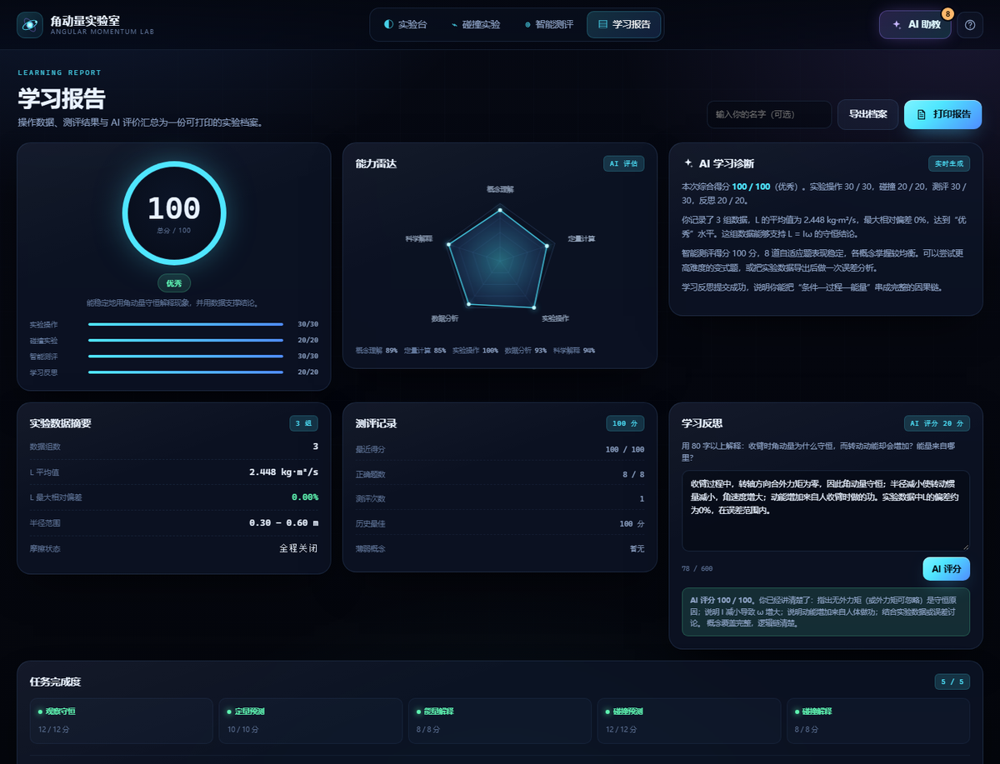
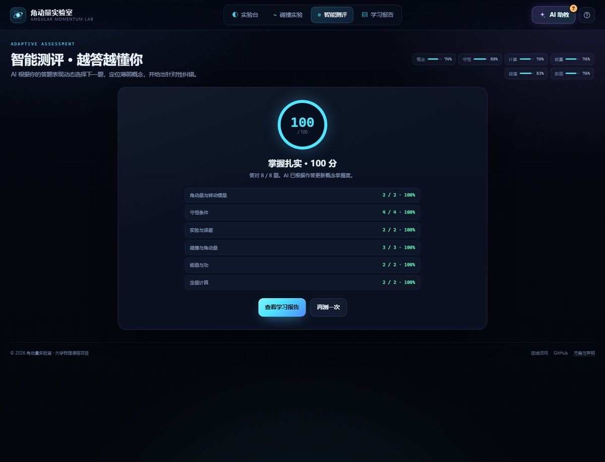
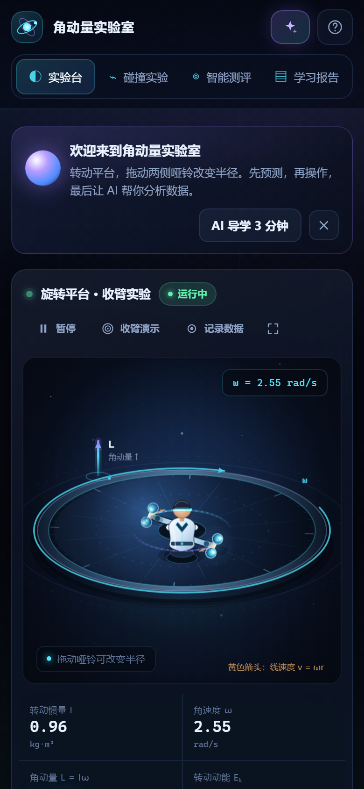

# 角动量守恒 · 虚拟仿真实验室

> 大学物理课程项目 · 可交互 / 可对话 / 可评估的 H5 虚拟仿真实验  
> 在线体验：<https://J66k6.github.io/wulizuoye/>  
> 手机扫码：打开页面右上角「?」→ 关于 / 帮助



| 碰撞实验 | 学习报告 |
| --- | --- |
|  |  |

| 智能测评 | 移动端 |
| --- | --- |
|  |  |

> 截图来自自动化验收生成的示例学习档案（满分状态），不包含真实学生数据。

## 这是什么

这是一个为大学物理「角动量守恒定律」设计的轻量级虚拟仿真实验。它不只是一个播放动画的页面，而是一条完整的探究闭环：

**预测 → 操作 → 测量 → 解释 → 反思 → 评估**

- **旋转平台**：拖动两侧哑铃改变转动惯量，观察角速度与转动动能如何变化，验证 \(L=I\omega\) 守恒；
- **子弹击杆**：调节子弹质量、速度与击点，先预测再发射，理解「角动量守恒但机械能不守恒」；
- **AI 助教**：读取实时物理量与实验数据，识别「角速度守恒」「能量也守恒」等迷思，按苏格拉底式提问引导；
- **自适应测评**：根据概念掌握度动态选题，每个干扰项都带针对性的错误解释；
- **学习报告**：汇总实验数据、测评、反思，生成 100 分制成绩、能力雷达与可打印档案；
- **移动优先**：响应式布局、触摸拖拽、全屏实验、PWA manifest，浏览器打开即用。

## 功能一览

| 模块 | 关键能力 |
| --- | --- |
| 实验台 | 拖拽 / 滑杆改变半径、实时 HUD、摩擦开关、收臂演示、数据记录、I–ω 理论曲线、CSV 导出 |
| 碰撞实验 | 三参数调节、碰前预测、慢放动画、能量条形对比、AI 迷思诊断 |
| 智能测评 | 8 道自适应题、数值题自动容差、逐项纠错、概念掌握度更新 |
| AI 助教 | 上下文计算、迷思纠正、下一步规划、随机出题与判题、量规评分、语音输入 / 朗读、可选云端 LLM |
| 学习报告 | 任务分、测评分、反思分、能力雷达、AI 诊断、打印 / JSON / CSV 导出 |
| 工程 | 原生 ES Modules、Canvas 2D、零后端、Node 物理单元测试、CDP 自动化验收 |

## 快速开始

```bash
# 在仓库根目录启动任意静态服务器
python -m http.server 8080
# 或 npm start
```

浏览器打开 <http://127.0.0.1:8080/>。不需要安装依赖，不需要构建。

物理内核测试：

```bash
node tests/physics.test.mjs
node tests/quiz.test.mjs
# 或 npm test
```

自动化浏览器验收（需要本机 Edge + 已开启 CDP 端口，详见 `tools/qa.mjs`）：

```bash
node tools/qa.mjs        # 视觉与基础交互
node tools/qa-flow.mjs   # 完整任务 / 测评 / 报告流程
node tools/qa-fps.mjs    # 帧率与加载时间
```

## 技术路线

```text
浏览器（HTML + CSS + 原生 ES Modules）
├── physics.js   纯物理模型：以 L 为状态量，半径变化严格守恒；Node 可测
├── render.js    Canvas 2D：旋转平台、子弹撞杆、I–ω 曲线、能力雷达
├── quiz.js      自适应测评：概念掌握度 + 难度匹配 + 干扰项诊断
├── ai.js        本地 AI 教学引擎：意图识别 / 物理计算 / 迷思规则 / 量规 / 报告
├── sound.js     Web Audio 实时合成音效（无音频资源）
├── main.js      状态、视图、事件、动画循环、持久化
└── vendor/qrcode.min.js  MIT 二维码库（仅用于分享）
```

- **零构建**：源码即产物，GitHub Pages 直接托管；
- **零后端**：学习记录保存在 `localStorage`，API Key 仅存 `sessionStorage`；
- **性能预算**：首屏文本资源约 335 KB（gzip ≈ 91 KB），无外部字体 / CDN / 图片依赖；
- **可访问性**：键盘可操作的滑杆、`aria` 标签、`prefers-reduced-motion` 降级。

## 物理模型与验证

| 场景 | 关系式 | 说明 |
| --- | --- | --- |
| 转台 | \(I=I_0+2mr^2\)，\(L=I\omega\)，\(E_k=L^2/(2I)\) | L 为积分状态量，改半径时自动守恒；摩擦作为外力矩作用于 L |
| 收臂 | \(\omega_1/\omega_0=I_0/I_1\) | I 减小 → ω 增大；Ek 增加来自人体做功 |
| 碰撞 | \(mvd=I\omega\)，\(I=ML^2/12+md^2\) | 绕支点角动量守恒；完全非弹性碰撞，机械能损失 |
| 摩擦 | \(\tau=b\omega+\tau_c\) | 开启后 L 单调衰减，用于对比「守恒大前提」 |

`tests/physics.test.mjs` 覆盖 14 项物理断言：守恒性、能量变化、摩擦衰减、碰撞角动量、杆端支点、预测评分、统计与边界。`tests/quiz.test.mjs` 另覆盖 11 项：自适应选题、判分与干扰项、量规评分、掌握度、AI 迷思纠正与下一步建议。

## AI 使用与学术诚信

本项目允许且实际使用了 AI 辅助编程。AI 参与范围包括：架构讨论、代码草稿与重构建议、测试用例设计、文案润色；物理公式、实验设计、评分量规、最终代码审查与数据校验由作者完成。AI 不被列为作者，也不对结论负责。

运行时唯一的第三方代码是 MIT 协议的 `qrcode-generator`；核心物理、渲染、AI 教学引擎、题库与报告均为原创。详见 [方案文档](docs/方案文档.md) 与 [THIRD_PARTY_NOTICES.md](THIRD_PARTY_NOTICES.md)。

## 文档

- [方案文档：选题背景 / 仿真目标 / 技术路线 / AI 赋能 / 可行性 / 用户手册 / 学术诚信](docs/方案文档.md)
- [用户手册（含 FAQ）](docs/用户手册.md)
- [第三方代码说明](THIRD_PARTY_NOTICES.md)

## 目录结构

```text
.
├── index.html                  # 单页应用入口
├── manifest.webmanifest        # PWA 清单
├── assets/
│   ├── css/main.css            # 设计系统与响应式
│   ├── js/
│   │   ├── physics.js          # 物理内核（可单测）
│   │   ├── render.js           # Canvas 场景与图表
│   │   ├── ai.js               # 本地 AI 教学引擎 / LLM 桥
│   │   ├── quiz.js             # 自适应测评
│   │   ├── sound.js            # Web Audio 音效
│   │   ├── main.js             # 应用控制器
│   │   └── vendor/             # qrcode-generator (MIT)
│   └── img/                    # 图标 / OG 分享图
├── docs/                       # 方案文档、用户手册、截图
├── tests/                      # Node 物理测试
└── tools/                      # 资产生成与浏览器自动化验收
```

## 许可

代码采用 MIT License；文档与实验设计版权归作者所有。第三方许可见 `THIRD_PARTY_NOTICES.md`。
